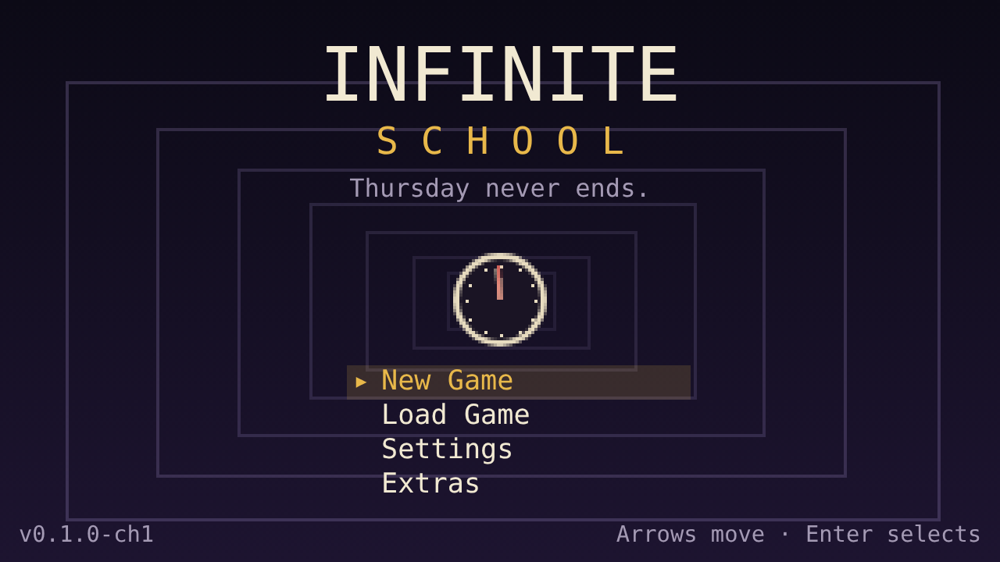
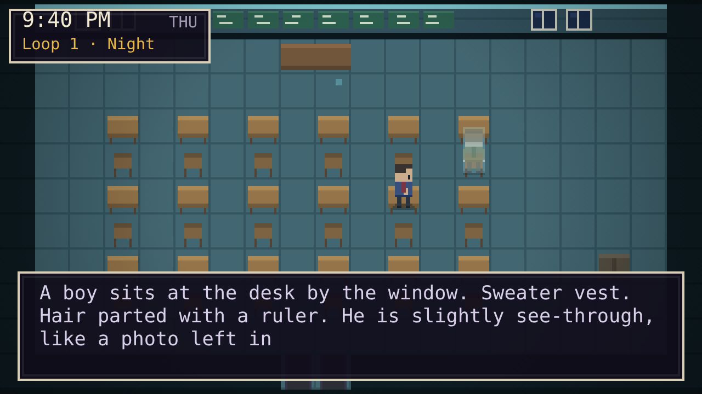
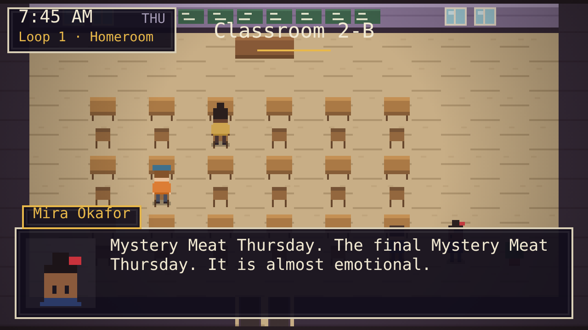
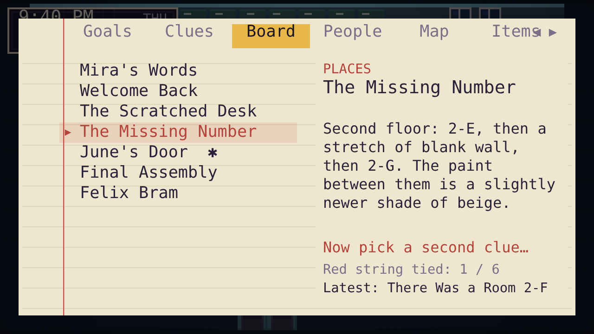
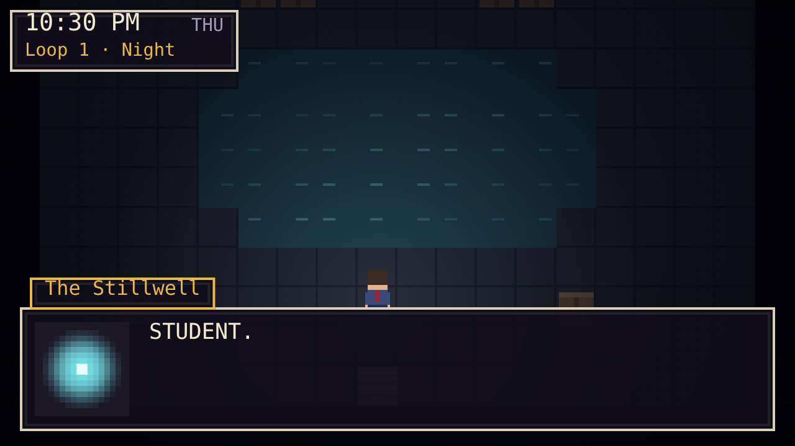

<p align="center">
  
</p>

<p align="center">
  <a href="https://jaineil32624.github.io/infinite-school/"></a>
</p>

<p align="center">
  <a href="https://jaineil32624.github.io/infinite-school/play/"><b>▶ Play in your browser</b></a> ·
  <a href="https://github.com/jaineil32624/infinite-school/releases/latest/download/infinite-school.apk"><b>⬇ Download Android APK</b></a> ·
  <a href="https://jaineil32624.github.io/infinite-school/">Website</a>
</p>

# Infinite School

A pixel-art mystery RPG about a school day that keeps repeating. You wake up at your desk in Classroom 2-B on Thursday, October 13, the last day before Halloway Academy closes forever. At midnight the bell rings and the day starts over. Everyone forgets. You don't.

Inspired by the emotional storytelling of Undertale, the social links of Persona and the exploration of classic RPGs. All characters, story, art, music and code are original.

## Play

- **Web:** https://jaineil32624.github.io/infinite-school/play/
- **Android:** download the [latest APK](https://github.com/jaineil32624/infinite-school/releases/latest/download/infinite-school.apk), open it, and allow installs from your browser when asked. A GitHub Action rebuilds it on every push.
- **Offline:** open `dist/infinite-school.html` in any browser (one self-contained file).
- **Dev:** serve the folder (`npx serve .` or `python -m http.server`) and open `index.html`.

### Controls

| Action | Keyboard | Controller |
|---|---|---|
| Move | Arrows / WASD | D-pad / left stick |
| Run | Shift | X / RT |
| Talk, inspect, confirm | Z / Enter / Space / E | A |
| Back | X / Backspace | B |
| Notebook | N / C / Tab | Y / Select |
| Pause | Esc / P | Start |

Touch controls appear automatically on phones and tablets.

## Screenshots

| | |
|---|---|
|  |  |
|  |  |

## What's in Chapter One: Homeroom

- **19 rooms** across two floors, the grounds, two hidden areas and something under the school
- **13 characters** on daily schedules that shift between loops (Mira, Theo, June, Mr. Grey, Ms. Marrow, Coach Dunmore, Mrs. Vell, Okon, Principal Hask, Felix and more)
- **The loop:** a real-time clock from 7:45 AM to midnight. Loop-local flags reset; what you *know* survives
- **Notebook + evidence board:** 28 clues, 6 deductions. Connecting two clues is how you progress: deductions open rooms, change dialogue and advance the story phase
- **Friendship:** bonds reset each loop for people who forget, but your *insight* into them carries over and unlocks deeper conversations. Loop-aware characters keep their bond
- **3 reachable endings** (plus 4 planned for later chapters), **22 achievements**, secrets, hidden rooms, a rotating library of lore books
- **9 original chiptune themes** generated live with Web Audio, all variations of one "Bell Motif"
- **Save system:** 3 manual slots + autosave every morning
- **Accessibility:** text speed, relaxed clock, large text, plain readable font, high contrast, glitch/flash reduction, screen-shake toggle, interaction sparkles, CRT filter, full controller and touch support

## Project layout

```
index.html          entry point (plain <script> tags, no bundler needed)
src/                engine
  core.js           namespace, RNG, storage, scene stack
  input.js          keyboard / gamepad / touch → abstract actions
  audio.js          chiptune sequencer + synthesized sound effects
  art.js            procedural pixel tiles, characters, portraits
  state.js          rules engine: conditions, effects, loop reset, saves
  world.js          rooms, movement, collision, schedules, lighting, glitch FX
  ui.js             every scene: title, dialogue, notebook, menus, endings
  main.js           boot + render loop
data/               content (edit these to grow the game)
  world.js          clues, deductions, items, objectives, lore books
  rooms.js          maps, exits, inspectable objects
  npcs.js           characters, looks, schedules, notebook profiles
  story.js          all dialogue and scenes
  meta.js           achievements and endings
  music.js          soundtrack patterns
tools/validate.js   content linter (maps, exits, ids, speakers)
tools/build.js      bundles everything into dist/infinite-school.html
docs/               story bible, roadmap, content guide
```

Run `node tools/validate.js` after editing content and `node tools/build.js` to rebuild the single-file version.

See [`docs/STORY_BIBLE.md`](docs/STORY_BIBLE.md) for the full five-phase story and [`docs/ROADMAP.md`](docs/ROADMAP.md) for the plan from here to a 15–20 hour game.

Created by Jaineil Rana.
